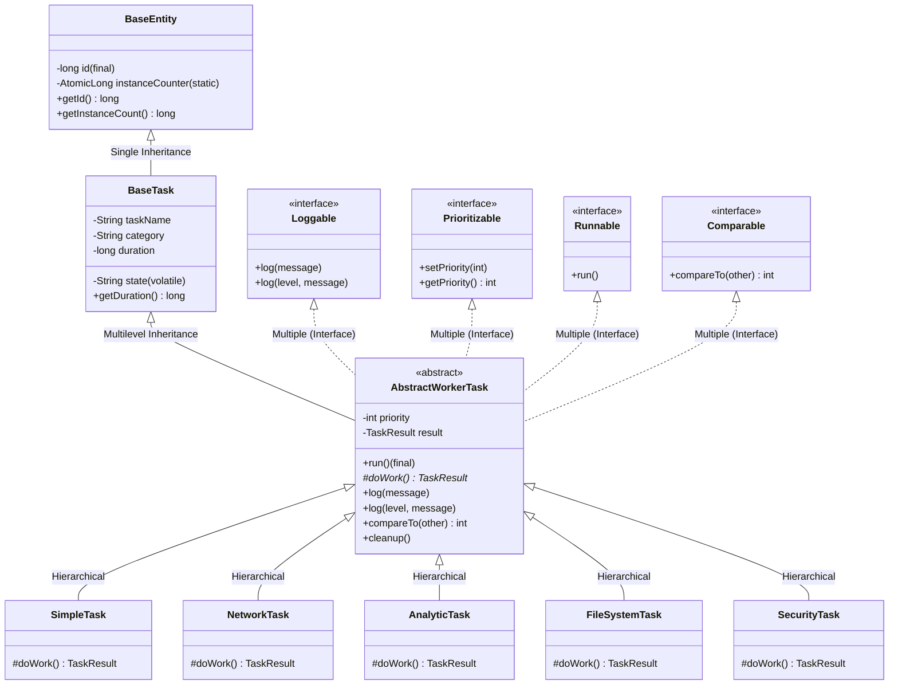

# 📐 Blueprint: Architectural Design & OOP Compliance

The **MASF (Modular Asynchronous Task Framework)** architecture demonstrates industry-grade structural integrity, modularity, and adherence to foundational Object-Oriented Programming (OOP) principles.

---

## ⚙️ Core OOP Requirements & Implementation Mapping

| # | Academic & Industry Requirement | Specific Implementation in MASF |
| :--- | :--- | :--- |
| **1** | **Single Inheritance** | `BaseTask` extends `BaseEntity` ([BaseTask.java](core/BaseTask.java)). |
| **2** | **Multilevel Inheritance** | `BaseEntity` $\to$ `BaseTask` $\to$ `AbstractWorkerTask` ([AbstractWorkerTask.java](core/AbstractWorkerTask.java)). |
| **3** | **Hierarchical Inheritance** | `AbstractWorkerTask` is extended by `SimpleTask`, `NetworkTask`, `AnalyticTask`, `FileSystemTask`, and `SecurityTask`. |
| **4** | **Multiple Inheritance (via Interfaces)** | `AbstractWorkerTask` implements `Runnable`, `Loggable`, `Prioritizable`, and `Comparable<AbstractWorkerTask>`. |
| **5** | **Hybrid Inheritance** | The overall hierarchy forms a unified hybrid tree combining class inheritance and interface implementation. |
| **6** | **Constructor Chaining (`this` & `super`)** | `BaseEntity()` chains to `this(System.nanoTime())`. Subclasses invoke `super(name)` to resolve field shadowing. |
| **7** | **Static, Final, & Abstract Modifiers** | `BaseEntity` has static counters and final IDs. `AbstractWorkerTask` is abstract with an abstract `doWork()` and a final `run()` template method. |
| **8** | **Method Overloading** | Overloaded logging methods in `AbstractWorkerTask`: `log(String)` and `log(String level, String message)`. |
| **9** | **Method Overriding & Polymorphism** | Subclasses override `doWork()`. Subclasses dynamically override default priority and payload generation. |
| **10**| **Dynamic Method Dispatch** | Demonstrated in `AsyncExecutor.executeTask(AbstractWorkerTask task)` and `Main.java` where parent references invoke subclass implementations at runtime. |
| **11**| **Resource Cleanup (Destructor Simulation)** | Enforced via `cleanup()` called in the `finally` block of `AbstractWorkerTask.run()`. |

---

## 📊 Class Relationships (UML Class Diagram)

---

## 🏗️ Layered Architecture

1. **Interface Layer (`/interfaces`)**:
   Defines behavior contracts (`Loggable`, `Prioritizable`, `TaskStateListener`).
2. **Core Domain Layer (`/core`)**:
   Defines domain laws and lifecycle abstractions (`BaseEntity`, `BaseTask`, `AbstractWorkerTask`, `TaskResult`, `TaskConstants`).
3. **Utility & Machinery Layer (`/utils`)**:
   Provides execution engines and thread-safe persistence (`AsyncExecutor`, `StateManager`, `FileService`).
4. **Verification & Test Layer (`/tests`)**:
   Standalone test suite validating contract adherence (`MASFTestSuite`).
