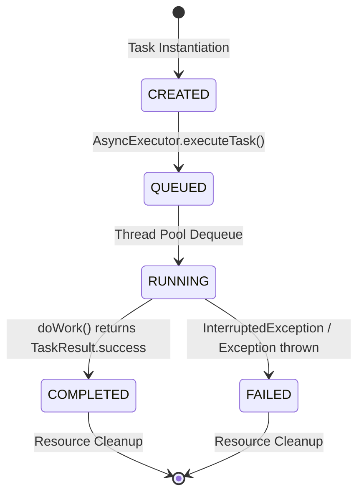

# ⚖️ Protocol: System Laws, State Machine, & Concurrency Invariants

The **MASF** protocol specifies the formal contracts and invariants that govern task transitions, priority dispatching, and thread safety across the system.

---

## 1. State Transition Law

Every task instance is governed by a finite state machine. A state transition cannot violate the monotonic forward lifecycle:

### Transition Invariants:
1. **Unidirectional Progress**: A task in `COMPLETED` or `FAILED` state cannot re-enter `RUNNING` or `QUEUED`.
2. **Observer Notification**: Every call to `transitionState()` broadcasts the change to all registered `TaskStateListener` observers synchronously before execution continues.
3. **Volatile Visibility**: The `state` variable in `BaseTask` is declared `volatile` to prevent CPU cache incoherence across worker threads.

---

## 2. Priority Scheduling Invariants

The engine enforces a 10-tier natural priority model ($1 = \text{Highest Priority}$, $10 = \text{Lowest Priority}$):

* **Tier 1 (Critical Security)**: Assigned to `SecurityTask`. Evaluates RBAC permissions and cryptographic signatures.
* **Tier 2 (External I/O & Integration)**: Assigned to `NetworkTask`. Handles remote API synchronization.
* **Tier 3 (Administrative File Audits)**: Assigned to `FileSystemTask`. Scans local disk and calculates SHA-256 digests.
* **Tier 4 (Data Analytics)**: Assigned to `AnalyticTask`. Performs statistical aggregation and $P_{95}$ distribution calculation.
* **Tier 6-10 (Compute & Background)**: Assigned to `SimpleTask` and generic worker tasks.

### Queue Ordering Guarantee:
Tasks submitted to `AsyncExecutor` are enqueued in a `PriorityBlockingQueue`. When a worker thread becomes available:
$$\text{Task}_A \prec \text{Task}_B \iff \left(\text{Priority}_A < \text{Priority}_B\right) \lor \left(\text{Priority}_A = \text{Priority}_B \land \text{ID}_A < \text{ID}_B\right)$$
This guarantees that ties are broken deterministically using creation order (FIFO).

---

## 3. Concurrency Safety Model

1. **Deterministic Barrier Synchronization**:
   Batch executions use a `CountDownLatch` initialized to the batch size ($N$). Completion listeners decrement the latch on `COMPLETED` or `FAILED`, eliminating arbitrary thread sleeping.
2. **CopyOnWrite Data Structures**:
   Observer listeners and state task collections leverage `CopyOnWriteArrayList` to ensure that iterations during reporting never throw `ConcurrentModificationException`.
3. **Atomic Identification**:
   Global entity counters are managed by `AtomicLong.incrementAndGet()`, guaranteeing uniqueness across hundreds of concurrent threads.

---

## 4. Telemetry & Persistence Protocol

1. **Activity Ledger (`data/logs/task_activity.log`)**:
   Every state modification is appended using synchronized NIO.2 file channels with millisecond timestamps, thread identifiers, and log levels.
2. **Execution Black Box (`data/reports/execution_summary.txt`)**:
   Upon batch completion, a complete system analytics report is exported containing:
   * Total task throughput & success rate.
   * Cumulative and average compute duration.
   * System bottleneck identification (slowest task identification).
   * Category distribution breakdown.
