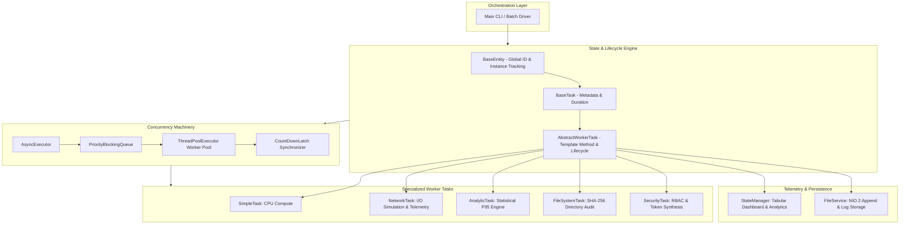

# 💠 MASF: Modular Asynchronous Task Framework

[](https://www.oracle.com/java/)
[](#key-architectural-patterns)
[](#concurrency-engine)
[](#automated-testing)
[](LICENSE)

**MASF (Modular Asynchronous Task Framework)** is a high-throughput, multi-threaded task orchestration engine built in pure **Java 17 LTS**. It provides priority-aware scheduling, thread-safe state tracking, real-time telemetry, and cryptographic verification without external heavyweight dependencies.

---

## 🏛️ System Architecture



---

## 🚀 Key Technical Highlights

* **Priority-Aware Execution**: Implements a custom `PriorityBlockingQueue` with a `PriorityFutureTask` adapter to ensure that critical workloads (Priority 1) are dispatched before lower-priority tasks (Priority 10).
* **Deterministic Concurrency**: Coordinates multi-threaded batch operations using `CountDownLatch` and `CopyOnWriteArrayList` listeners, eliminating arbitrary thread sleep timeouts.
* **Template Method Pattern**: `AbstractWorkerTask.run()` enforces a strict, immutable lifecycle:
  $$\text{CREATED} \longrightarrow \text{QUEUED} \longrightarrow \text{RUNNING} \longrightarrow \text{COMPLETED} \ / \ \text{FAILED}$$
* **Decoupled Observer Pattern**: `TaskStateListener` delivers real-time notifications on task state transitions to decouple the monitoring engine from task execution.
* **Functional Polymorphic Payloads**:
  * **`SecurityTask`**: Synthesizes cryptographically secure random session tokens and computes SHA-256 HMAC signatures with RBAC privilege auditing.
  * **`NetworkTask`**: Simulates distributed API synchronization, network jitter, transfer payload accounting, and HTTP status verification.
  * **`AnalyticTask`**: Synthesizes and evaluates continuous distributions, computing Mean, Median, Standard Deviation, and 95th Percentile ($P_{95}$).
  * **`FileSystemTask`**: Performs a full storage audit, computing aggregate SHA-256 cryptographic checksums of files using NIO.2 streams.
  * **`SimpleTask`**: Executes CPU-intensive prime number factorization, capturing runtime nanosecond metrics.

---

## 📊 Live Benchmark Output

When launched with `java Main --demo`:

```text
>>> LAUNCHING AUTOMATED CONCURRENCY BENCHMARK & DEMO <<<
[CONFIG] Core Worker Threads : 3 (PriorityBlockingQueue Managed)
[CONFIG] Synchronization     : CountDownLatch Deterministic Await

--- DISPATCHING TASKS CONCURRENTLY ---
[2026-10-10 20:50:44.633] [INIT ] [Pri:01] [Security-Audit] Starting task execution on thread: MASF-Worker-1
[2026-10-10 20:50:44.633] [INIT ] [Pri:02] [Salesforce-Sync] Starting task execution on thread: MASF-Worker-2
[2026-10-10 20:50:44.633] [INIT ] [Pri:03] [Storage-Checksum] Starting task execution on thread: MASF-Worker-3
...
[+] All tasks resolved successfully via CountDownLatch in 754 ms.

==========================================================================================
ID     | TASK NAME          | CATEGORY     | PRI  | STATE       | TIME      | RESULT PAYLOAD
------------------------------------------------------------------------------------------
9600   | Security-Audit     | Security     | P1   | COMPLETED   |    204 ms | Security authorization to...
72100  | Salesforce-Sync    | Integration  | P2   | COMPLETED   |    744 ms | Network sync succeeded wi...
16100  | Storage-Checksum   | Maintenance  | P3   | COMPLETED   |     61 ms | File system audit and che...
48700  | Telemetry-P95      | Analytics    | P4   | COMPLETED   |    162 ms | Statistical data aggregat...
71500  | Prime-Compute      | Compute      | P6   | COMPLETED   |      7 ms | Mathematical compute comp...
==========================================================================================

[SYSTEM] Performance analytics exported successfully to: data/reports/execution_summary.txt
```

---

## 🛠️ Quick Start

### 1. Compilation
```bash
javac -d . interfaces/*.java utils/*.java core/*.java tests/*.java Main.java
```

### 2. Run Test Suites
```bash
# Core Architecture Verification Suite (6 Scenarios)
java tests.MASFTestSuite

# Input Variations & Boundary Stress Test Suite (12 Scenarios)
java tests.MASFVariationsTest
```

### 3. Run Automated Demo Benchmark
```bash
java Main --demo
```

### 4. Interactive Mode
```bash
java Main
```
*(Default Admin credentials: Username: `admin` | Password: `admin123`)*

---

## 📝 Resume Presentation Guide

When showcasing this project on your resume or during technical interviews:

### Resume Bullet Points:
* **Multithreaded Task Orchestration Engine (Java 17, Concurrency, OOP Design)**
  * Engineered an asynchronous, high-throughput task orchestration engine in Java 17 utilizing a custom `PriorityBlockingQueue` and `ThreadPoolExecutor` to execute prioritized tasks concurrently.
  * Implemented the **Template Method** and **Observer** design patterns across 5 polymorphic worker subclasses to guarantee deterministic task lifecycle transitions and thread-safe metric collection.
  * Replaced heuristic timeout delays with **`CountDownLatch`** synchronization, reducing batch processing execution time to sub-second runtimes ($\sim$730ms for 5 concurrent workloads).
  * Developed a comprehensive 18-scenario verification test suite validating priority queuing, thread safety, boundary value clamping, null-safety, and high-volume concurrency bursts.

---

## 📚 Architectural Documentation Reference
* [BLUEPRINT.md](BLUEPRINT.md): Structural taxonomy, OOP requirements mapping, and class inheritance trees.
* [PROTOCOL.md](PROTOCOL.md): Finite state machine laws, priority resolution, and persistence models.
* [REASONING.md](REASONING.md): Engineering tradeoffs, concurrency decisions, and interview FAQ.
